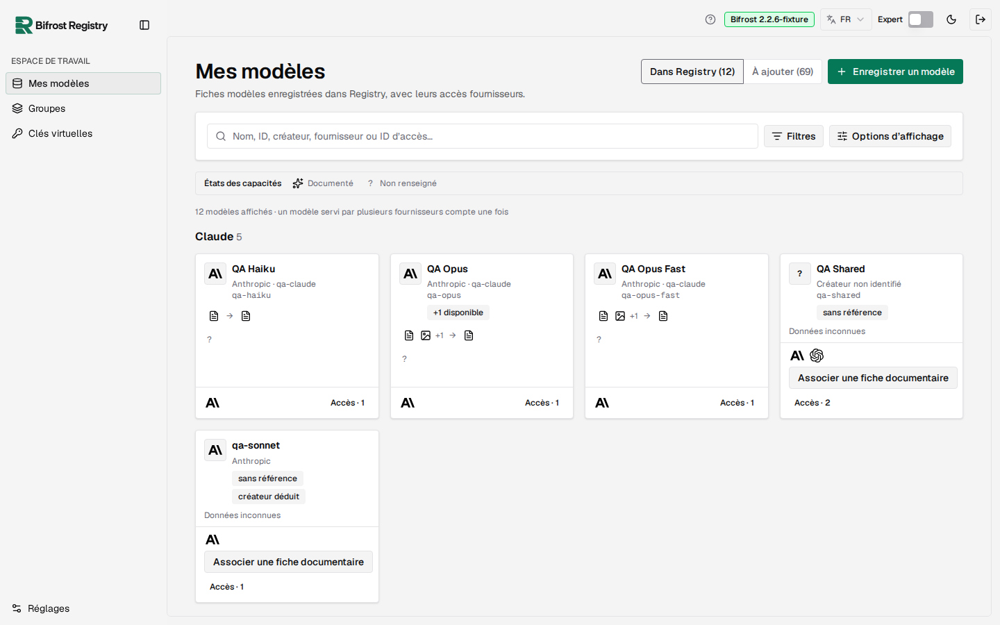
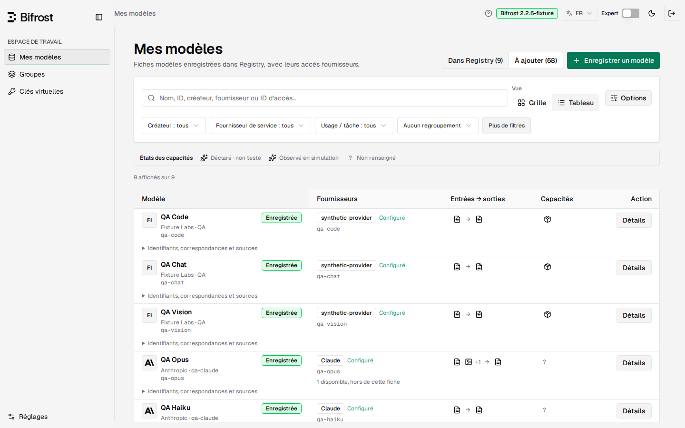
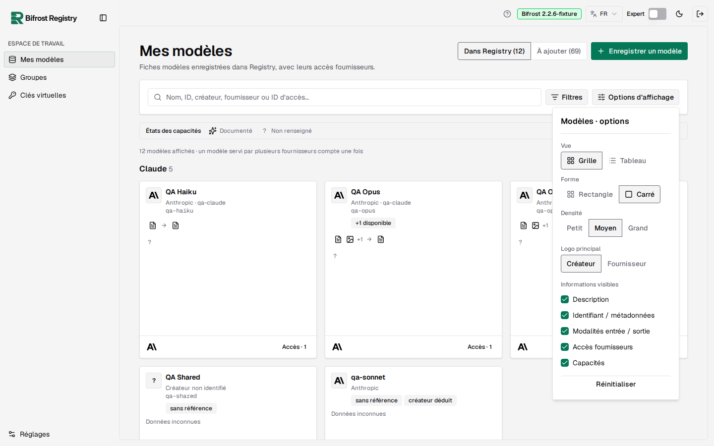
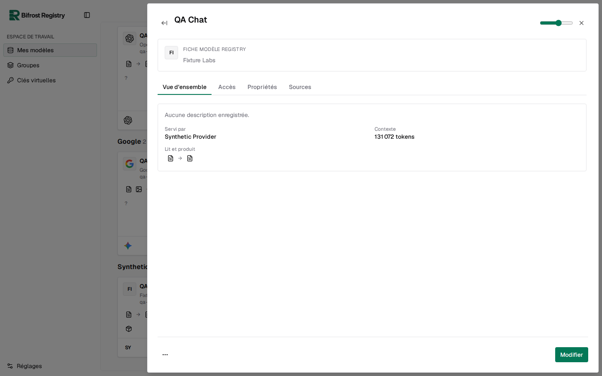
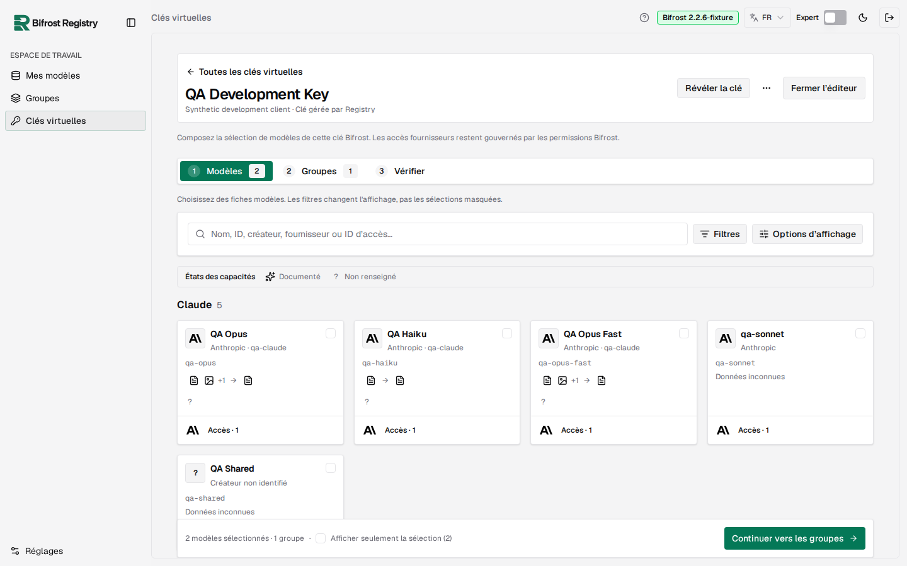
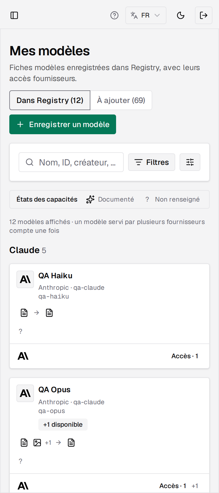

<div align="center">

<picture>
  <source media="(prefers-color-scheme: dark)" srcset="ui/public/branding/registry/registry-logo-dark.svg">
  
</picture>

# Bifrost Registry

**Un catalogue de modèles fiable et une composition d'accès par clé pour les clés virtuelles Bifrost.**

Organisez chaque modèle une seule fois, puis décidez exactement de ce que chaque clé virtuelle peut atteindre — via une interface embarquée qui tourne à côté de votre gateway Bifrost existant.

[](https://github.com/sofianbll/bifrost-plugin-registry/actions/workflows/ci.yml)
[](https://github.com/sofianbll/bifrost-plugin-registry/releases/tag/v0.4.0)
[](LICENSE)

[English](README.md) · Français

</div>



*Un catalogue consultable des références Models.dev et Bifrost, avec provenance par champ et corrections révisables.*

L'interface est **anglaise par défaut** ; le français est disponible en un clic (sélecteur de langue) ou via `?lang=fr`.

## Ce que fait Registry

- **Catalogue Models.dev embarqué** — un instantané de référence versionné et reproductible, avec provenance par champ, liens canoniques et corrections manuelles qui survivent aux rafraîchissements.
- **Endpoints par accès** — chaque accès fournisseur choisit ses opérations exposées indépendamment (Chat Completions et Responses sont des choix distincts).
- **Sélection d'accès par clé** — choisissez ce que chaque clé virtuelle peut atteindre ; exclusions et ajouts sont révisés avant publication.
- **Corrections de prix natives** — corrections tarifaires et accès restreint par clé appliqués via la gouvernance Bifrost elle-même, pas une couche parallèle. Les limites techniques ne sont pas appliquées nativement.
- **Routage natif restreint** — publiez des alias partagés qui ne routent que parmi les accès retenus par chaque clé.
- **UI embarquée + import/export** — panneau React sur son propre port, instantanés JSON versionnés avec aperçu et sauvegarde, export CSV aplati.

## Démarrage rapide

```bash
# 1. Récupérez l'image dynamique Bifrost 2.3.0 publiée (Linux AMD64 ou ARM64, sans plugin)
docker pull ghcr.io/sofianbll/bifrost-dynamic:2.3.0
# 2. Fournissez les deux identifiants admin et un volume persistant sur /app/data
export REGISTRY_ADMIN_TOKEN=…  REGISTRY_BIFROST_AUTH='Basic …'
# 3. Ajoutez le .so correspondant par URL directe dans les réglages plugin de Bifrost
#    https://github.com/sofianbll/bifrost-plugin-registry/releases/download/v0.4.0/bifrost-registry-v0.4.0-linux-<amd64|arm64>.so
# 4. Ouvrez le panneau
open http://127.0.0.1:8099/model-registry
```

**[Installation, configuration et retour arrière complets →](docs/fr/INSTALL.md)** — deux modes : l'image dynamique publiée plus l'URL du plugin, ou le plugin seul sur tout Bifrost compilé avec chargement dynamique. Si l'ajout du plugin échoue avec une erreur de permission sur un fichier temporaire, voir [Dépannage](docs/fr/TROUBLESHOOTING.md).

## Captures d'écran

| | |
| --- | --- |
| <br>**Grille** — cartes à hauteur égale avec provenance par champ | <br>**Tableau** — comparaison dense par créateur et famille |
| <br>**Options d'affichage** — formes et densités grille/carré/tableau | <br>**Fiche modèle** — un modèle, des accès fournisseurs distincts |
| <br>**Compositeur de clé** — politiques d'accès basic et expert | <br>**Mobile** — les mêmes parcours à 400 px |

## Pourquoi

Bifrost gouverne l'inférence, les identifiants, les budgets et le routage. Ce qu'il ne donne pas à l'opérateur, c'est une image fiable et révisable de ce que chaque clé virtuelle peut réellement atteindre. Registry comble ce trou : un catalogue des références Models.dev et Bifrost, avec provenance par champ et corrections manuelles qui survivent aux rafraîchissements, composé en politiques d'accès pour les clés virtuelles.

L'embarquement d'un instantané Models.dev versionné rend le catalogue reproductible et hors-ligne — aucune dépendance d'exécution vers une API tierce. L'image du gateway est un Bifrost 2.3.0 non modifié compilé avec chargement dynamique, et Registry reste un plugin installé séparément : le chemin d'inférence auquel vous faites confiance n'est jamais patché.

Projet indépendant, pas un produit officiel Maxim/Bifrost.

## Pour aller plus loin

- [Installation](docs/fr/INSTALL.md) — fichiers de release, identifiants, stockage persistant, mise à jour et retour arrière.
- [Configuration](docs/fr/CONFIGURATION.md) — fiches Registry, groupes, politiques de clé et anciennes datasheets.
- [Guide utilisateur](docs/fr/USER-GUIDE.md) — enregistrement de modèles, sources, groupes et composition de clés.
- [Dépannage](docs/fr/TROUBLESHOOTING.md) — permissions du répertoire temporaire, `Dynamic loading not supported`, échecs d'activation.
- [Compilation native](docs/BUILD.md) — compiler le gateway et le `.so` avec des dépendances compatibles.
- [Index de la documentation](docs/fr/README.md) · [Changelog](CHANGELOG.md) · [État](STATUS.md).

## Exécution et qualification

**Release stable courante :** v0.4.0 cible Bifrost 2.3.0 non modifié (`9237ec06672406e437b3cb33fc793ffd0403b3ae`) ; [STATUS consigne sa qualification native AMD64/ARM64 et les sondes des images publiées](STATUS.md). L'installation initiale par URL reste prise en charge, mais la récupération d'activation passe explicitement à un chemin local persistant contenant les mêmes octets vérifiés avant redémarrage ; ni la récupération URL seule ni la réactivation locale à chaud ne sont revendiquées. Voir la [procédure de récupération d'activation](docs/fr/INSTALL.md#recuperer-l-activation-apres-desactivation). La mise à niveau en place depuis v0.3.0/2.2.6 n'est pas qualifiée : arrêtez le gateway, sauvegardez tout le volume, puis changez ensemble image et plugin. N'installez jamais les assets v0.3.0 sur le gateway 2.3.

La release stable **v0.4.0**, publiée le 16 octobre 2026 depuis le commit Registry `ba59b878f824f04e54bdd5e9760352c2727ea245`, associe Bifrost 2.3.0, Go 1.27.1 et Alpine 3.23 pour Linux AMD64 et ARM64 (musl). Depuis v0.3.0 : identité Registry (#158), récupération d'activation par chemin local persistant (#159), corrections de justesse (#157), retrait des prototypes/Laboratoire/galerie (#162), groupes de dépendances (#136/#137) et outils de maintenance (#161). Le projet est désormais en [maintenance](docs/agents/maintenance.md) ; #102 reste différé avec sa spécification approuvée conservée. v0.3.0 reste publiée pour Bifrost 2.2.6. La qualification native et les sondes d'image utilisent uniquement des fournisseurs synthétiques, sans inférence réelle ni certification de production ; [STATUS](STATUS.md) donne les artefacts, empreintes et limites exactes. Aucun gateway réel ni la production n'ont été touchés par cette release.

Les résultats ci-dessous ont été enregistrés sur la release plus ancienne **v0.3.0-rc.4** (ARM64, Bifrost 2.2.3, commit final `d588a9f` ; interface en anglais par défaut), dont rc.5 à rc.8 recompilent le code et que v0.3.0 fait évoluer.

| Contrôle | Résultat |
| --- | --- |
| Gateway `bifrost-http` | `80d17483…` (build reproductible) |
| Plugin `bifrost-registry.so` | `ff21df8f…` |
| Isolation `/v1/models` par clé | 42/42 |
| Installation autonome, redémarrage, désactivation | 55/55 |
| Autonome + assistant synthétique | 72/72 |
| Adoption de clés natives | 19/19 |
| Capacités par accès (prix, VK restreinte, alias partagé) | 34/34 assertions |

[Rapport de qualification ARM64](reports/bifrost-2.2.3-arm64-869e251/README.md) · [Audit final](docs/reviews/2026-09-28-final-audit.md)

**Limites honnêtes.** Les résultats détaillés ci-dessus sont ARM64 seulement ; rc.5 a ajouté la qualification AMD64 et ARM64 pour Bifrost 2.2.4, et rc.6 à v0.3.0 l'ont répétée pour les cibles suivantes ; les preuves propres à v0.4.0 figurent plus haut. L'image officielle précompilée reste non qualifiée, et l'image dynamique téléchargée est qualifiée séparément du `.so`. Toutes les suites de release utilisent des fournisseurs synthétiques, **sans inférence réelle**. La suite d'adoption de rc.4 utilise un bridge réseau limité au loopback ; les autres suites utilisent `--network none`. Une paire candidate précédente a été installée par URL sur une copie de test d'un gateway de production ([STATUS](STATUS.md), en anglais) ; aucun déploiement de production n'a été effectué. L'intégration à la barre latérale native n'est pas livrée ; #7 et la draft PR #60 sont clos.

## Contribuer

Ouvrez d'abord une issue avec un bug reproductible ou un cas d'usage concret, puis une pull request vers `main`. Lisez [CONTRIBUTING.md](CONTRIBUTING.md) pour les exigences et la commande `make check` complète. Les issues suivent les [cinq étiquettes de triage](docs/agents/triage-labels.md) du dépôt.

## Support

Posez vos questions et signalez les bugs via [GitHub Issues](https://github.com/sofianbll/bifrost-plugin-registry/issues). Pour les questions d'usage et de configuration, commencez par le [guide utilisateur](docs/fr/USER-GUIDE.md).

## Sécurité

Signalez les vulnérabilités en privé via [le rapport privé GitHub](https://github.com/sofianbll/bifrost-plugin-registry/security/advisories/new) ; n'ouvrez jamais d'issue publique avec des identifiants ou un exploit. Voir [SECURITY.md](SECURITY.md) pour le périmètre et les limites de confiance.

## Code de conduite

Ce projet suit le [Contributor Covenant v2.1](CODE_OF_CONDUCT.md). Signalez les comportements inacceptables via les canaux privés de [SECURITY.md](SECURITY.md).

## Licence

Le code écrit par le projet est sous [licence MIT](LICENSE). Le code et les assets UI Bifrost vendored conservent leur [licence Apache-2.0](ui/LICENSE), et les polices Geist conservent leur [SIL Open Font License](ui/public/static/fonts/OFL.txt). Voir [les notices tierces](THIRD_PARTY_NOTICES.md) et [la provenance upstream](ui/PROVENANCE.md).
