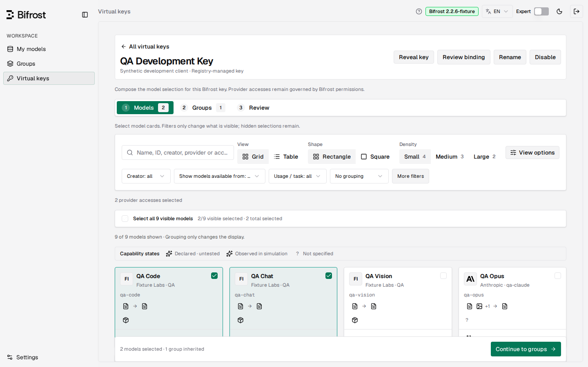
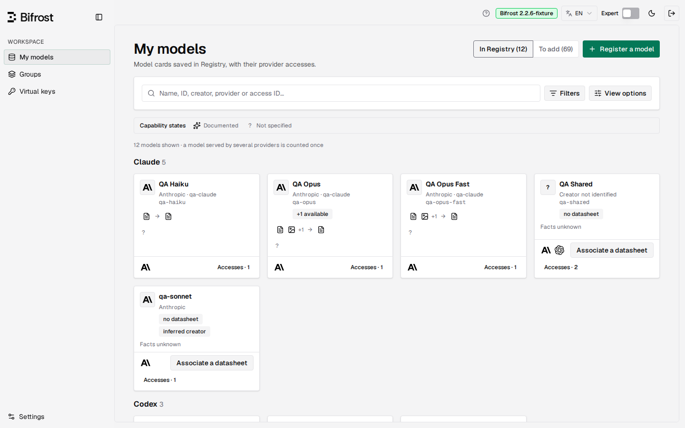
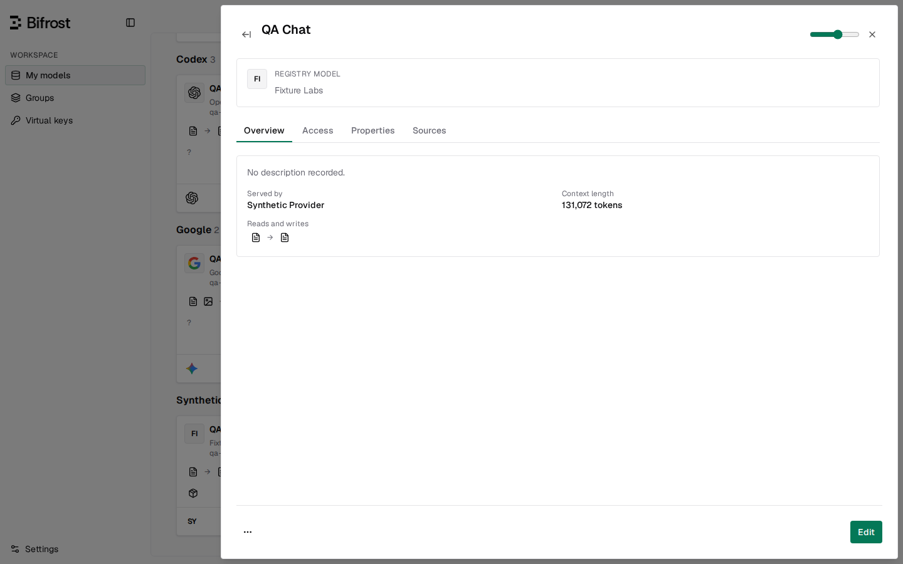
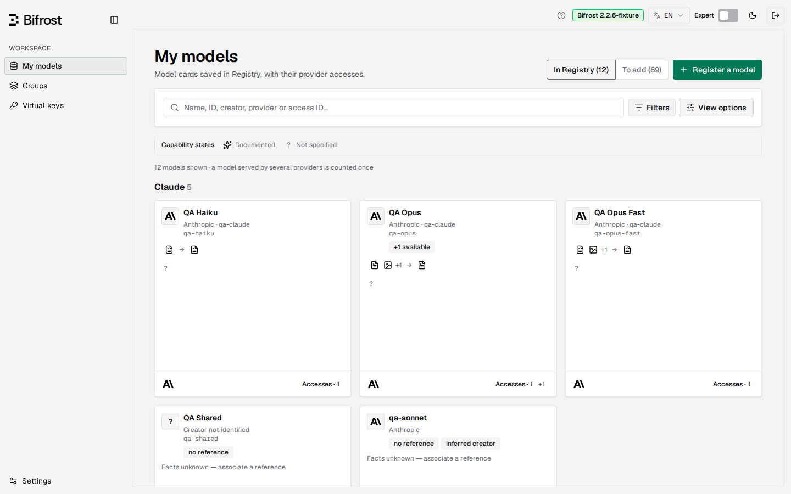

# Choose models for an application

English · [Français](fr/USER-GUIDE.md)

Prepare the model selection for an existing Bifrost test key, publish it and check what Bifrost lists for that key.

## Before you start

Use a test gateway with Registry installed and connected, configured providers and models available through those providers.

Choose an existing, enabled and unexpired Bifrost key for this application. Create the key and set its initial permissions in Bifrost if needed; this guide does not create one.

## 1. Prepare the models

In **My models**, find the cards you want to use and check their provider accesses. If a card is missing, open the discovered model and choose **Register**. Provide a valid call name, a display name and at least one complete access with its provider and exact model ID.

Select the exposed operations for each access: Chat Completions and Responses are separate choices. Review and register the card; optional details such as prices can remain unknown. Choosing an operation does not prove that the provider supports it.

**Register** creates a model card, not access for a key. **Add** attaches an access to a card, or a card to a key or group. You will choose this key’s models in step 3.

## 2. Open or adopt the key

In **Keys**, find the application’s key. Choose **Open** if Registry already manages it, **Adopt** if it is ready, or **See what blocks it** to inspect what is missing.

Resolve prerequisites first: register missing model cards, or enable or renew the key in Bifrost, then refresh the preview. These are separate from the provider decisions in the adoption dialog. For each decision, compare the existing permissions and the proposed selection; keeping a provider in Bifrost leaves its permissions outside Registry’s management.

For an option marked **Changes Bifrost**, review the exact before/after preview before confirming the change. Replacing “all providers” can remove models without cards and no longer allows future providers automatically. Only these marked options change native permissions.

Once the prerequisites and decisions are resolved, adopt the key. Adoption does not widen native permissions or publish pending selection changes.

## 3. Choose models and accesses

Add the models this application needs. A selected model includes **all its linked accesses by default**: review the **Accesses** list and uncheck any this key should not use.

These local exclusions affect only this key, including when a group supplies the model. They change neither the group nor other keys.

To reuse a selection, you can also [use a group](#_3-compose-groups-and-keys). This is optional. Changing a shared group affects all keys that inherit it; keep key-specific exceptions in the key.

*Example of a key’s model selection. Fictional data.*

## 4. Review and publish

Review the selected models, their call names and their accesses in the draft preview. This preview is the planned selection, not a list already confirmed by Bifrost.

Click **Publish**. Registry saves the selection and immediately asks Bifrost which models this key lists. Read the result in the next step.

## 5. Read the result

**Verified**: Bifrost confirmed the published selection. **Differences found**: inspect the missing or unexpected model IDs and correct the selection or gateway configuration as needed. **Not checked yet**: the total is still the planned selection; use **Check with Bifrost**.

**Verified · 1 difference** is also possible: a permission kept in Bifrost is not listed by Bifrost. Inspect that difference; the unlisted model never counts in the verified total.

Use **Check again** if you need to repeat the comparison. This check reads `/v1/models` with the key; it calls no model and therefore does not prove that inference will succeed. A listed ID is not proof of routing or provider capabilities either.

## Other cases and reference

Find [registration details](#_1-register-a-model), [groups and adoption options](#_3-compose-groups-and-keys), [snapshot limitations](#_4-local-snapshot-versus-connected-gateway) or [installation checks](INSTALL.md). [Find another guide](README.md).

The interface includes **Settings → Help** and a help button in the header. This guide describes the current interface; [STATUS](https://github.com/sofianbll/bifrost-plugin-registry/blob/main/STATUS.md) records release and qualification boundaries.

### Registration fields and operations

Open **My models**, inspect a discovered model and choose its provider accesses. Each access retains its exact provider and native model ID. The common model ID is the name Registry will expose according to the key's naming preference.

Provide a valid common ID, display name, and at least one complete access. Select the exposed operations independently for each access: Chat Completions and Responses are separate choices. Existing selections survive editing; newly discovered accesses start with no operations selected. The editor identifies missing required values before Review. Creator, series, prices and capabilities may remain unknown. Choosing an operation permits that Registry request type; it does not test whether the provider supports it.

The model panel can be expanded while retaining the current draft. Review the summary and save. Saving a documentary reference alone does not grant access to a model.

### Source data and provenance

**Settings → Sources** shows synchronization dates, failures and catalog counts. Open the catalog data for per-field provenance, corrections, exact reference mappings and manual reference creation.

- **Models.dev** supplies a versioned local reference snapshot generated with its upstream core. Its source commit and date identify the data; the refresh date only records when Registry imported that snapshot. Canonical links, provider-specific values and explicit omissions are preserved, as are local corrections and manual reference mappings.
- **Bifrost** supplies gateway configuration and declared model data. A declared value is a source claim, not an inference test.
- **Unknown** means the information is unavailable; it does not mean unsupported or zero.
- **Custom references** can be created under Catalog data → Reference cards → New reference. Connect the appropriate access explicitly afterward.

The current release embeds this Models.dev snapshot; the previous release does not. Refreshing it does not download a newer upstream version: updating the embedded data requires regenerating the snapshot and compiling a new release. Technical limits (context length, maximum tokens) stay descriptive: Registry does not apply them natively. Generic additional source connectors remain separate work. See [the Models.dev analysis](https://github.com/sofianbll/bifrost-plugin-registry/blob/main/docs/design/models-dev-reuse-research.md).

### Shared groups and adoption details

Groups are reusable model selections. In a key, a selected model includes all its linked accesses by default. When a selected model has more than one access, the key composer lists them under **Accesses** with a checkbox each: unchecking one excludes that provider access for this key only, without changing the shared group. Basic and Expert share the same draft. Expert is available on wide screens.

For a pre-existing Bifrost key, choose **Adopt**, or **See what blocks it** when prerequisites or decisions remain; **Open** opens a key already managed by Registry. Registry compares native permissions with registered accesses. If a model must be registered to preserve the key's existing routes, the preview identifies it. Confirm only after reviewing the proposed selection. Adoption cannot widen Bifrost permissions.

Each key card says whether the key is **Ready to adopt**, **Blocked** (with the reason) or **Empty**, and the Keys page filters on that state. The adoption dialog opens on a numbered list of the decisions left before adopting, one per provider, each with its choices and model counts: models Bifrost does not list (for example a disabled provider) cannot be added from Registry, but you can **Keep Mistral in Bifrost** (the button carries the provider's name): Registry then does not manage or change that provider's permissions, adopts the rest of the key, and reads its routes back with the others (the key card and page show the provider as "kept in Bifrost"). A model the key allows through two providers is adopted through one of them: keep either provider in Bifrost. Models Bifrost lists but Registry has no card for lead to **Show in To add**, filtered on those models. That keeps the current key draft while you register the prerequisites. Reviewing adoption is also available with unsaved changes. Applying adoption preserves those changes for review and does not publish the pending selection.

A blocker can also be removed from the key itself, in Bifrost, from the adoption dialog only: **Remove these models from the key in Bifrost** (models Bifrost does not list) and **Replace “all providers” by the explicit list**. Each opens a preview with the exact change: what the key allows today and afterwards, and every model that stops being allowed. Nothing is written to Bifrost until you confirm, and the result is read back from Bifrost before it is reported. Replacing “all providers” keeps the providers Bifrost lists models for, each limited to the models Registry holds a configured direct access for (adoption cannot represent an “all models” list), so models without a card stop being allowed and providers added to Bifrost later are not allowed until you add them to the key. Registry never edits an adopted key's native permissions.

Then compose groups, direct additions and local exclusions. Exclusions apply to that key without changing the shared group. Review the resulting IDs, publish and read back `/v1/models`. Readback verifies the listed IDs, not model inference.

### Local snapshot versus connected gateway

The banner identifies the source and capture date. A partial capture can contain unavailable aliases or discovery results.

A snapshot supports local model/catalog editing and local key selection preparation where its adoption plan is valid. It does not modify the original gateway. Its credentials and model listing are simulated, so successful preparation is not proof of live access. Secrets were excluded: revealing a real key, live readback, source refresh and provider calls are unavailable.

The standalone panel uses its own access token and server-side gateway credentials. A compatible native host integration can share Bifrost's authenticated admin surface. This requires the specific compatible host/plugin build; it is not established by opening the snapshot page or installing the current official gateway image.

### Appearance and gateway details

**Settings → Appearance** contains shared display preferences and provider logo overrides. Logos may use an existing icon or an imported PNG, JPEG or WebP. These preferences are saved only in this browser and do not change provider identity or permissions.

Catalogue pages offer Grid and Table views. In Grid, cards can be Rectangle or Square and use Small, Medium or Large density.

The gateway inventory shows captured providers, key permissions, aliases and routing. Tree and detail views show the same data. An alias maps a requested name to a provider target; a deployment can be that provider-specific target. Routing rules select targets using the captured conditions and weights. Missing or encrypted aliases remain explicitly unavailable.
